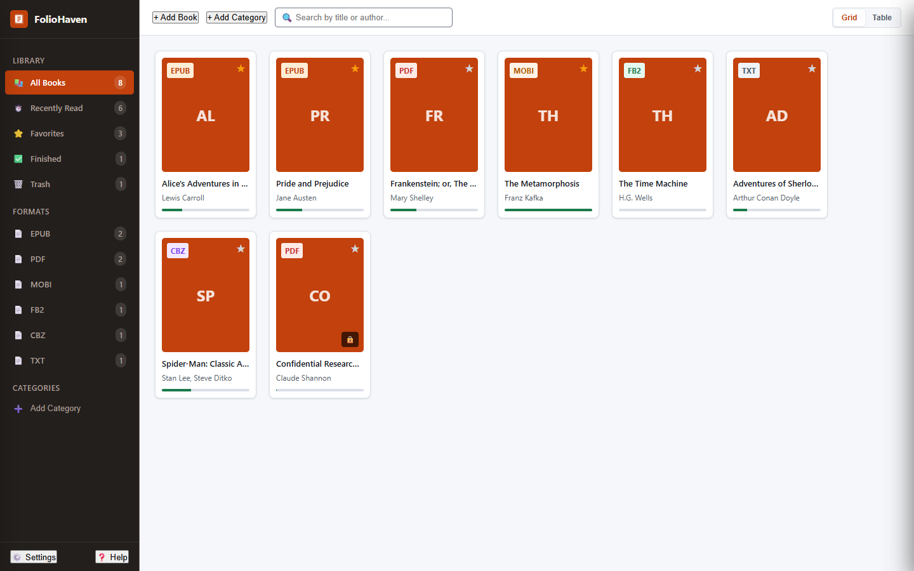
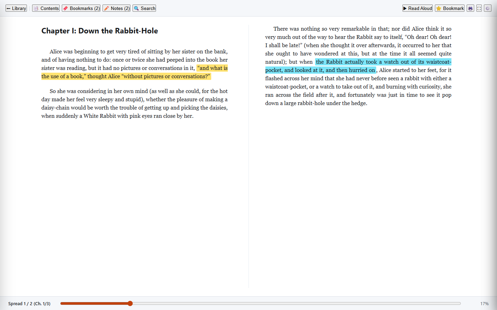
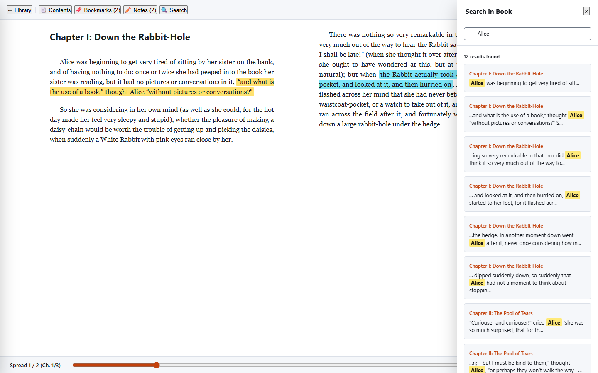
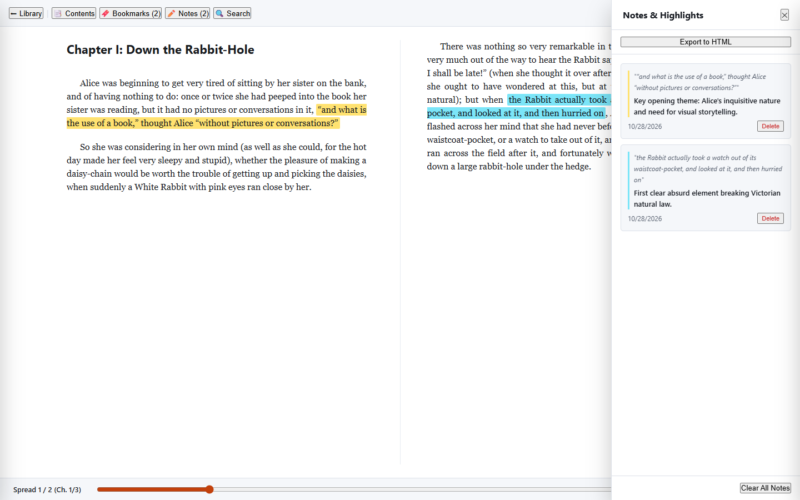

# FolioHaven

<p align="center">
  
</p>

<p align="center">
  <strong>Serene Digital Bookshelf & Distraction-Free Ebook Reader</strong><br>
  A modern, privacy-first desktop & web reading companion for EPUB, PDF, MOBI, FB2, CBZ, and TXT formats.
</p>

<p align="center">
  <a href="https://foliohaven.vercel.app"></a>
  <a href="https://github.com/FeurisPT2/foliohaven/releases/tag/v1.0.1"></a>
  <a href="LICENSE"></a>
  <a href="https://foliohaven.vercel.app/reader"></a>
  <a href="#"></a>
</p>

---

## 🌟 Overview

**FolioHaven** is a clean-room, privacy-first recreation of desktop reading software, designed for book lovers, researchers, and students who value typography, focus, and quiet study. 

Unlike proprietary desktop readers bogged down with advertisements, nag screens, arbitrary format restrictions, or cloud lock-in, FolioHaven runs entirely offline, keeps all your books in your local storage, and delivers a calm, archival reading canvas.

### Why FolioHaven?

- 🔒 **100% Local & Private:** No telemetry, no account registration, and zero cloud uploads. Your library, bookmarks, and notes remain strictly on your machine.
- 📖 **Universal Format Support:** Read reflowable **EPUB**, fixed-layout **PDF**, **MOBI**, **FB2**, **CBZ** comic archives, and plain **TXT** files.
- 🎨 **Anti-Slop Craftsmanship:** Built under strict `tasteskill v2` guidelines—featuring hand-crafted SVG iconography, museum-grade artwork, authentic typography (`Crimson Pro` and `Plus Jakarta Sans`), and WCAG AAA-compliant reading palettes.
- ⚡ **Lightweight & Fast:** Zero bulky frontend frameworks. Powered by lean native Web APIs, IndexedDB persistence, and an optimized canvas/DOM rendering engine.

---

## 🚀 Live Demo & Downloads

| Target | Access Link | Description |
| :--- | :--- | :--- |
| **Native Windows App (100% C++20 / Qt 6)** | [Download 26MB Portable Zip (GitHub)](https://github.com/FeurisPT2/foliohaven/releases/download/v1.0.1/FolioHaven-1.0.1-Native-Windows-x64.zip) | **Pure Native 64-bit C++20 binary (~846 KB)**. Zero Chromium/Electron overhead, boots in milliseconds, uses native SQLite WAL and Windows SAPI speech. |
| **Web Reading App** | [Open FolioHaven Web App](https://foliohaven.vercel.app/reader) | Run instantly in any modern browser (Chrome, Edge, Firefox, Safari). Drag & drop your ebooks to start reading immediately. |
| **Product Landing Page** | [Visit Marketing Site](https://foliohaven.vercel.app/) | Interactive showcase, design philosophy, feature deep-dive, and live demo. |

---

## ✨ Key Features

### 📚 Digital Bookshelf & Organization
- **Multiple Views:** Switch seamlessly between **Book Shelf (Covers)**, **Detailed Grid**, and **Compact Table List**.
- **Custom Shelves:** Create, rename, and manage custom collections (e.g. *Favorites*, *Research*, *Fiction*, *To Read*).
- **Search & Filter:** Instant real-time filtering across titles, authors, file formats, and reading progress.
- **Custom Covers:** Replace book cover art with custom images or auto-generated book plates.
- **Shelf Lock:** Optional PIN/password lock to safeguard private collections.

### 👓 The Calm Reading Canvas
- **Ergonomic Reading Themes:**
  - ☀️ **Day Mode:** Warm ivory/paper background with deep charcoal typography.
  - 📜 **Sepia Mode:** Soothing archival parchment tone engineered for long study sessions.
  - 🌙 **Night Mode:** OLED-friendly deep dark canvas with muted off-white text.
  - 🪵 **Dark Sepia Mode:** Low-contrast warm night palette for twilight reading.
- **Flexible Layouts:** Single-page reading, dual-column spreads, adjustable margins, font scaling, and custom line heights.
- **Distraction-Free Fullscreen:** Press `F` to immerse yourself in pure text without window chrome.

### ✍️ Study Tools & Annotation
- **Harmonious Highlighting:** Select text and highlight using 4 color swatches (*Amber*, *Emerald*, *Azure*, *Rose*).
- **Inline Commentary:** Add rich notes to any selected passage.
- **Export Study Notes:** Export all highlights, chapter references, and annotations to a clean, standalone, printable HTML document with one click.
- **Quick Bookmarks:** Save important pages and quickly jump between bookmarks.

### 🎙️ In-Book Search & Text-to-Speech (TTS)
- **Instant Search:** Full-text keyword and regex search with highlighted occurrences and direct jump-to-result navigation.
- **Native TTS Read-Aloud:** Built-in speech synthesis with play, pause, resume, speed control (0.75x – 2.0x), and system voice selection.

---

## 📸 Visual Tour

| Library Management (Shelf View) | Immersive Reader Canvas |
| :---: | :---: |
|  |  |

| In-Book Search & Navigation | Notes, Highlights & Annotations |
| :---: | :---: |
|  |  |

---

## ⌨️ Keyboard Shortcuts

| Shortcut | Action |
| :--- | :--- |
| <kbd>→</kbd> / <kbd>PageDown</kbd> / <kbd>Space</kbd> | Next page / advance spread |
| <kbd>←</kbd> / <kbd>PageUp</kbd> / <kbd>Shift</kbd> + <kbd>Space</kbd> | Previous page |
| <kbd>Home</kbd> / <kbd>End</kbd> | Jump to start / end of book |
| <kbd>F</kbd> | Toggle distraction-free Fullscreen |
| <kbd>Ctrl</kbd> + <kbd>F</kbd> | Open In-Book Search |
| <kbd>Ctrl</kbd> + <kbd>B</kbd> | Toggle Bookmark on current page |
| <kbd>Esc</kbd> | Close reader / Exit fullscreen / Dismiss modal |

---

## 🏗️ Architecture & Project Structure

FolioHaven is built with a 100% Pure Native C++20 / Qt 6 architecture for desktop Windows and modular vanilla Web Standards for browsers, completely free of Electron and Chromium runtimes:

```
icecream_ebook_reader_replica/
├── src/                      # 100% Pure Native C++20 / Qt 6 Desktop Source
│   ├── app/
│   │   └── main.cpp          # Desktop application entry point & CLI ingestion
│   ├── engine/
│   │   ├── DocumentEngine.h  # Native ebook parser (EPUB, PDF, MOBI, FB2, CBZ, TXT)
│   │   └── DocumentEngine.cpp
│   ├── storage/
│   │   ├── DatabaseManager.h # Native SQLite WAL persistence & migrations
│   │   └── DatabaseManager.cpp
│   └── ui/
│       ├── ReaderWindow.h    # High-performance Qt 6 desktop window & SAPI TTS
│       └── ReaderWindow.cpp
├── app/                      # Static Web Reader & Marketing Site (Offline-First)
│   ├── assets/               # Screenshots, fine art CC0 imagery & credits
│   ├── app.js                # Web UI controller, events, views, and shortcuts
│   ├── db.js                 # IndexedDB local storage engine (books, notes, shelves)
│   ├── engine.js             # Ebook parsing and rendering engine (EPUB/PDF/TXT/etc.)
│   ├── index.html            # Web reader application interface
│   ├── landing.html          # High-converting marketing & demo landing page
│   ├── styles.css            # Component styles & typography
│   ├── tokens.css            # Design tokens (colors, elevation, typography scales)
│   └── vercel.json           # Edge routing configuration for Vercel
├── replica/                  # Architecture specs, brand guidelines, and test plans
├── scripts/                  # Screenshot automation and utility scripts
├── tests/                    # End-to-end and unit test suites
├── CMakeLists.txt            # Modern CMake build definition for Native Desktop
├── vercel.json               # Root deployment routes config
└── README.md                 # Project documentation
```

---

## 🛠️ Local Development & Build

### 1. Building the 100% Native C++20 / Qt 6 Desktop App

Requirements: MinGW-w64 GCC 13+ or MSVC 2022, CMake 3.20+, Qt 6.6+ (Core, Gui, Widgets, Sql, Svg).

```bash
# Configure with CMake and Ninja
cmake -B build_native -G Ninja -DCMAKE_CXX_COMPILER=g++

# Build native executable
cmake --build build_native

# Deploy dependencies for portable distribution
windeployqt --release build_native/FolioHaven.exe
```

The resulting standalone executable `FolioHaven.exe` is only **~846 KB** and requires zero Electron or Node runtime.

### 2. Running the Web Version
The web application is pure static HTML/CSS/JS with zero external dependencies. You can run it with any static HTTP server:

```bash
# Start a local static server
npx serve app

# Then open in your browser:
# Landing Page: http://localhost:3000/landing.html
# Reader App:   http://localhost:3000/index.html
```

---

## 🧪 Testing & Verification

FolioHaven includes automated tests covering format parsing, search routines, local database migrations, and landing page responsiveness:

```bash
# Run unit and integration feature tests
python tests/test_cloned_features.py

# Run launch artifact and schema verification
python tests/test_launch_artifacts.py

# Run full end-to-end test suite
python tests/e2e_suite.py
```

---

## 🎨 Asset & Artwork Attribution

The archival aesthetic of FolioHaven incorporates public domain fine art courtesy of the **Art Institute of Chicago** (CC0 Public Domain Designation):
- *Interrupted Reading* (c. 1870) — Jean-Baptiste-Camille Corot
- *French Library of the Louis XV Period* (c. 1937) — Mrs. James Ward Thorne

Formal provenance and licensing records are documented in [`app/assets/credits.json`](app/assets/credits.json).

---

## 📄 License

FolioHaven is distributed under the terms of the **[MIT License](LICENSE)**. Free for personal, educational, and commercial use.
